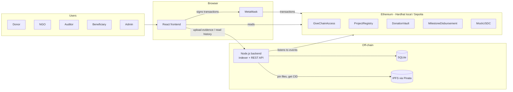
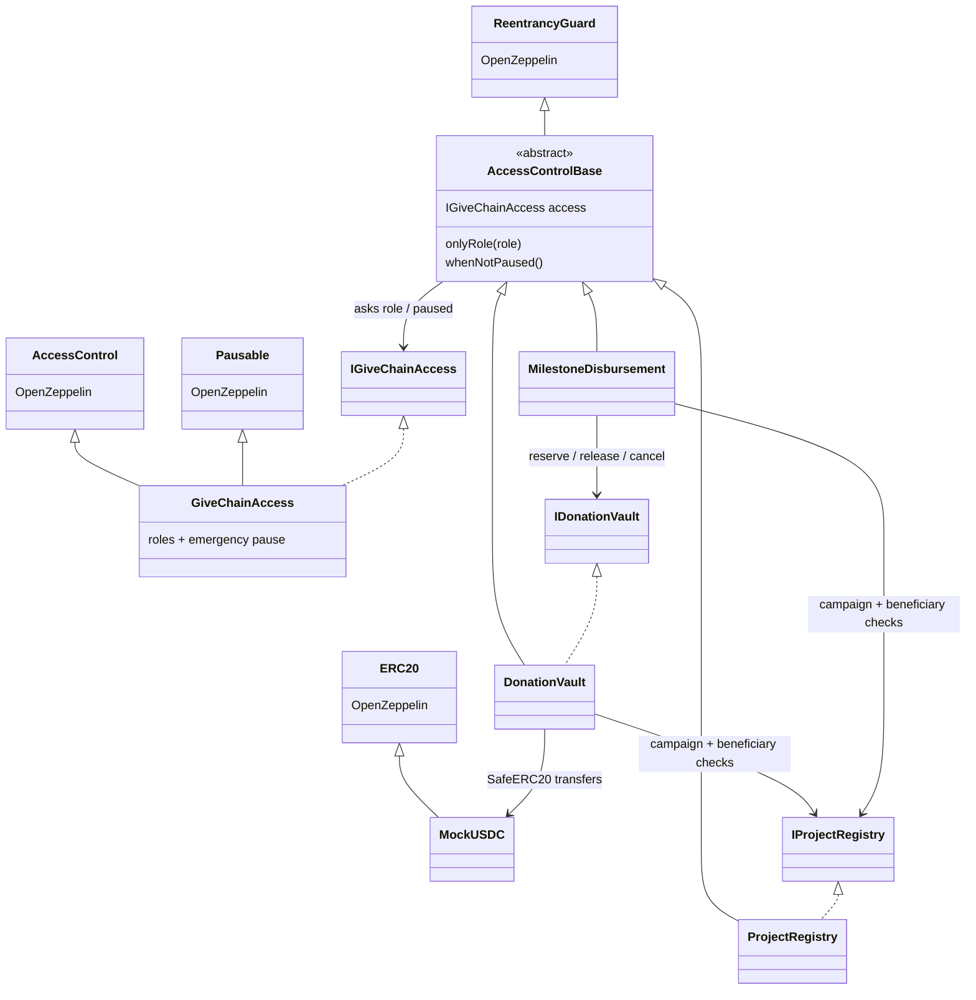
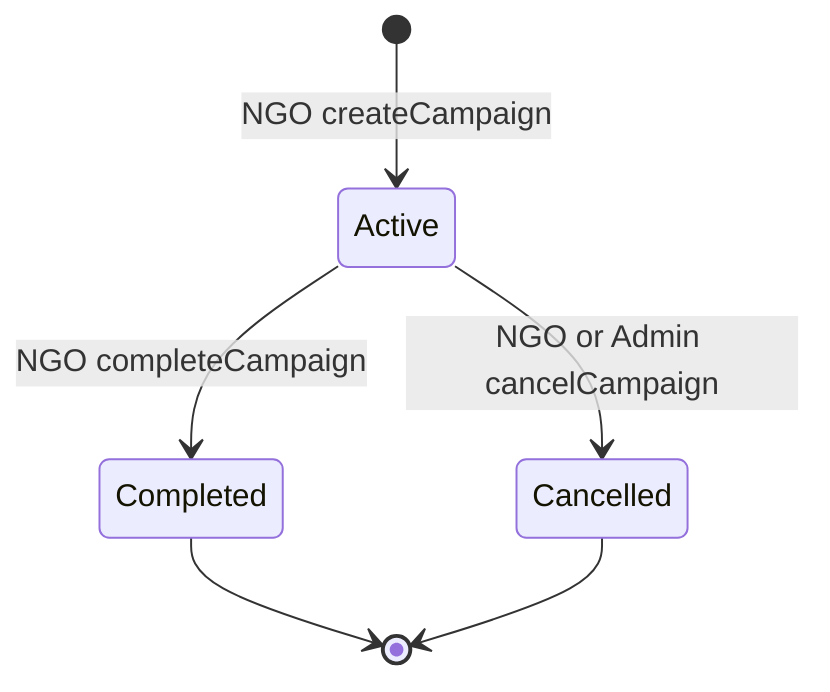
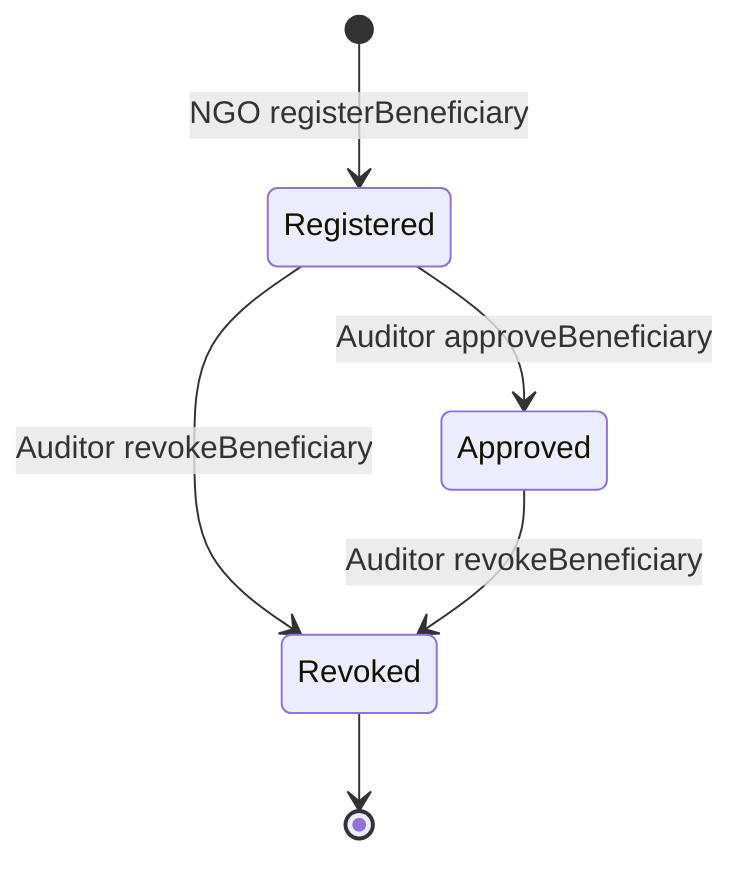
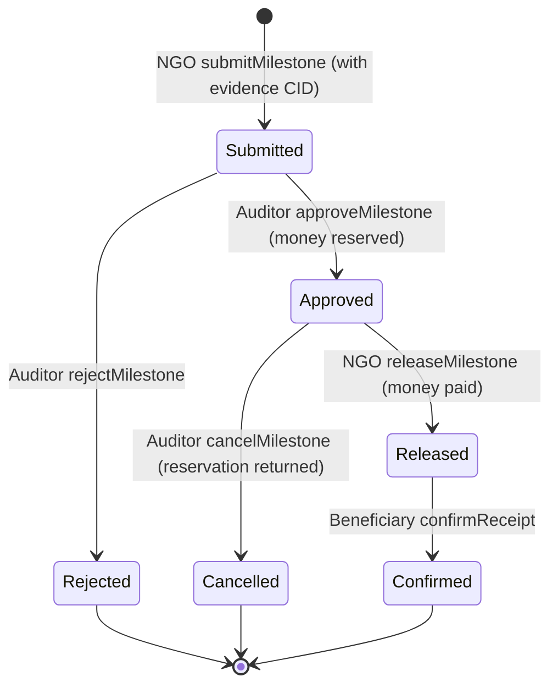
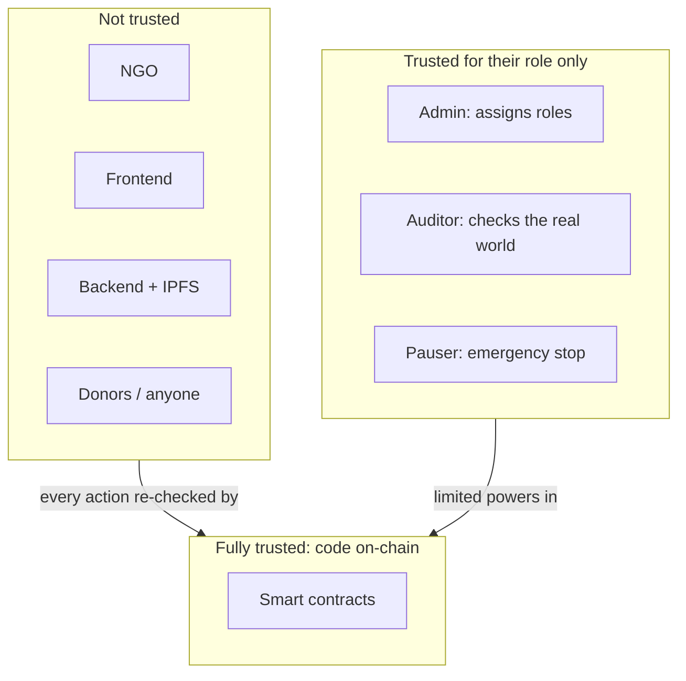

# GiveChain Architecture

Core principle: **the NGO never holds the money.** Donations sit in a smart-contract vault, and the vault pays beneficiaries directly once an independent auditor has approved the payment.

This document is the design that Phase 2 builds. Diagrams use Mermaid, which GitHub renders automatically.

## 1. Components

| Component | Job | Trusted for |
|---|---|---|
| Smart contracts | Hold the money and enforce every rule | Everything involving money and permissions |
| MetaMask | Holds each user's private key and signs transactions | Proving who is acting |
| React frontend | Screens for each role | Nothing; contracts re-check everything |
| Node.js backend | Uploads evidence to IPFS; copies on-chain events into a searchable database | Convenience only; anyone can rebuild its data from the chain |
| IPFS | Stores evidence files and campaign details | File integrity (the CID changes if the file changes), **not** that the file is true |

## 2. Contracts and inheritance

| Contract | Responsibility |
|---|---|
| `GiveChainAccess` | Stores all roles and the single emergency pause switch. |
| `AccessControlBase` (abstract) | Reusable code every other contract inherits: `onlyRole` and `whenNotPaused` modifiers that ask `GiveChainAccess`, plus reentrancy protection. |
| `ProjectRegistry` | Campaigns and beneficiaries. Holds no money. |
| `DonationVault` | Holds all MockUSDC. Keeps a **separate balance per campaign**, handles donations, reservations, payouts and refunds. |
| `MilestoneDisbursement` | The payment workflow: submit, approve, reject, release, cancel, confirm receipt. Holds no money. |
| `MockUSDC` | Test dollar token (6 decimals) with a free faucet for the demo. |

**Why inheritance:** the role and pause checks are identical in three contracts, so they are written once in `AccessControlBase`.

**Why a separate access contract:** roles are granted once and one pause switch stops everything. Before, the NGO role had to be granted in each contract and an emergency needed three pause calls.

**Why composition between the other contracts:** each contract owns one kind of data and exposes only what the others need, through the interfaces in `contracts/interfaces/`.

**Why the vault does not trust MilestoneDisbursement:** a bug in the workflow contract must not be able to send money to the wrong person. The vault therefore checks campaign status, beneficiary eligibility, balance and duplicate payouts again on its own.

## 3. Roles and permissions

Roles live in `GiveChainAccess`. Donors and beneficiaries need no role; anyone with a wallet can donate, and a beneficiary is identified by being registered in a campaign.

| Action | Admin | NGO | Auditor | Pauser | Donor | Beneficiary |
|---|:-:|:-:|:-:|:-:|:-:|:-:|
| Grant / revoke roles | ✅ | | | | | |
| Pause / unpause the whole system | | | | ✅ | | |
| Create campaign | | ✅ | | | | |
| Complete own campaign | | ✅ own | | | | |
| Cancel campaign | ✅ any | ✅ own | | | | |
| Register beneficiary | | ✅ own campaign | | | | |
| Approve / revoke beneficiary | | | ✅ | | | |
| Submit milestone (payment request) | | ✅ own campaign | | | | |
| Approve / reject milestone | | | ✅ not own campaign | | | |
| Cancel approved milestone | | | ✅ | | | |
| Release approved milestone | | ✅ own campaign | | | | |
| Donate | anyone | anyone | anyone | anyone | ✅ | anyone |
| Claim refund | | | | | ✅ own donations | |
| Confirm receipt | | | | | | ✅ own milestone |

Contract-to-contract permission: only the `MilestoneDisbursement` address may call `reserveFunds`, `releaseFunds` and `cancelReservation` on the vault. That address is set **once** after deployment and can never be changed, so not even the admin can later point the vault at a different contract.

**What the admin cannot do:** move money, approve beneficiaries or approve milestones. The admin manages people, not funds.

**Separation of duties:** `GiveChainAccess` refuses to give one wallet both the NGO and the Auditor role. MilestoneDisbursement additionally refuses an approval from the campaign's own NGO wallet, in case roles change later.

## 4. State transitions

### Campaign

- Donations, reservations and payouts happen only while **Active**.
- Once **Completed** or **Cancelled**, the campaign's money is frozen. Each donor can claim back their share of the unspent money once (see section 5).
- Approved milestones that were not yet released when the campaign closed can no longer be paid. Their money becomes part of the refundable amount. The frontend warns the NGO before closing a campaign with unpaid approvals.

### Beneficiary (per campaign)

- The same wallet cannot be registered twice in one campaign.
- The same identity commitment (hashed ID, see section 6) cannot be registered twice in one campaign, even with a different wallet.
- The same person may be a beneficiary in different campaigns.

### Milestone (one payment to one beneficiary)

- A milestone can be paid **at most once**: both the milestone contract and the vault record it as paid.
- An NGO may submit several milestones for the same beneficiary (for example monthly food aid). The auditor reviews each one.
- Approval fails if the campaign does not have enough available money. Submission does not check money, because donations may still arrive.
- An auditor cannot approve milestones of a campaign whose NGO wallet is their own (separation of duties).

## 5. Money accounting (per campaign)

The vault keeps these numbers for every campaign:

| Value | Goes up when | Goes down when |
|---|---|---|
| `donated` | someone donates | never |
| `reserved` | a milestone is approved | it is released or cancelled |
| `released` | a milestone is paid | never |
| `refunded` | a donor claims a refund | never |

`available = donated − reserved − released − refunded`

The vault always checks: total MockUSDC held = sum over all campaigns of (`donated − released − refunded`).

**Refund rule.** When a campaign is Completed or Cancelled, a donor may claim once:

`refund = donorContribution × (donated − released) / donated`

Example: a campaign raised 1,000 and paid out 400 before it was cancelled. A donor who gave 100 (10%) gets back 10% of the remaining 600, which is 60. Integer division can leave a few millionths of a cent in the vault; this is documented as a known limitation.

## 6. On-chain vs off-chain data

| Data | Where | Why |
|---|---|---|
| Campaign id, NGO wallet, target, status | On-chain | Rules depend on it |
| Campaign title, description, images | IPFS. Full CID in the `CampaignCreated` event; `keccak256(CID)` in storage | Too large and costly for the chain; the stored hash still proves which file was published (gas optimization 3) |
| Beneficiary wallet and status | On-chain | Payouts depend on it |
| Beneficiary identity commitment | On-chain | Hash of `salt + national ID`, computed off-chain. Blocks duplicate people without revealing who they are. A random salt per person stops anyone guessing IDs from the hash. |
| Beneficiary name, ID number, documents | **Never on-chain**; kept by the NGO | Personal data. Public chains are permanent and readable by everyone. |
| Milestone amount, beneficiary, status | On-chain | Rules and transparency depend on it |
| Milestone evidence CID | Full CID in the `MilestoneSubmitted` event; `keccak256(CID)` in storage | Cheaper than storing the text; the hash fixes the evidence permanently |
| Evidence files (receipts, photos) | IPFS | The CID proves the file is unchanged since submission. It does **not** prove the event really happened; that is what the auditor's approval is for. |
| Donations, payouts, refunds | On-chain (events + balances) | The core transparency promise |
| Searchable history, totals for dashboards | Backend database | Built only from on-chain events, so it can be deleted and rebuilt at any time |

## 7. Trust boundaries

| Boundary | Risk | How it is handled |
|---|---|---|
| NGO → contracts | NGO tries to pay itself or a fake beneficiary | NGO never holds money; beneficiaries and payments need auditor approval |
| Auditor | Auditor colludes with the NGO | Cannot approve own campaign; every approval is public and permanent on-chain. In production: several auditors. |
| Admin | Admin key stolen | Admin cannot move money; vault's payout contract cannot be changed. In production: multisig wallet. |
| Frontend / backend | Shows wrong data or is offline | Contracts are the source of truth; anyone can check the chain directly; backend data can be rebuilt from events |
| IPFS | File unavailable or misleading | CID on-chain proves which file was submitted; the auditor judges the content |
| MilestoneDisbursement → vault | Bug in workflow contract | Vault re-checks status, eligibility, balance and duplicates itself |
| Vault → token | Malicious token calls back into the vault | Reentrancy guard and checks-effects-interactions; tested with a malicious mock token |

## 8. Events (what the backend indexes)

| Contract | Event |
|---|---|
| ProjectRegistry | `CampaignCreated`, `CampaignStatusChanged`, `BeneficiaryRegistered`, `BeneficiaryStatusChanged` |
| DonationVault | `DonationReceived`, `FundsReserved`, `ReservationCancelled`, `FundsReleased`, `RefundClaimed` |
| MilestoneDisbursement | `MilestoneSubmitted`, `MilestoneApproved`, `MilestoneRejected`, `MilestoneCancelled`, `MilestoneReleased`, `ReceiptConfirmed` |
| GiveChainAccess | OpenZeppelin `RoleGranted`, `RoleRevoked`, `Paused`, `Unpaused` |

## 9. Deployment order

1. `GiveChainAccess` (deployer becomes Admin and Pauser)
2. `MockUSDC`
3. `ProjectRegistry(access)`
4. `DonationVault(access, registry, token)`
5. `MilestoneDisbursement(access, registry, vault)`
6. `vault.setDisbursementContract(milestoneDisbursement)` (one time only)
7. Grant NGO and Auditor roles in `GiveChainAccess`

## 10. Known limitations (by design for a university prototype)

- The auditor's approval is a human judgement. Blockchain proves what was approved and paid, not that aid was really delivered.
- IPFS files stay available only while someone pins them.
- Contracts are not upgradeable. A bug fix means redeploying.
- A single admin and auditor are used in the demo. Production would use multisig wallets and several auditors.
- Pro-rata refunds can leave a tiny remainder in the vault from integer division. A donor whose share rounds down to zero cannot claim (tested).
- The vault supports standard ERC-20 tokens only. Fee-on-transfer or rebasing tokens would break its accounting; MockUSDC is neither.
