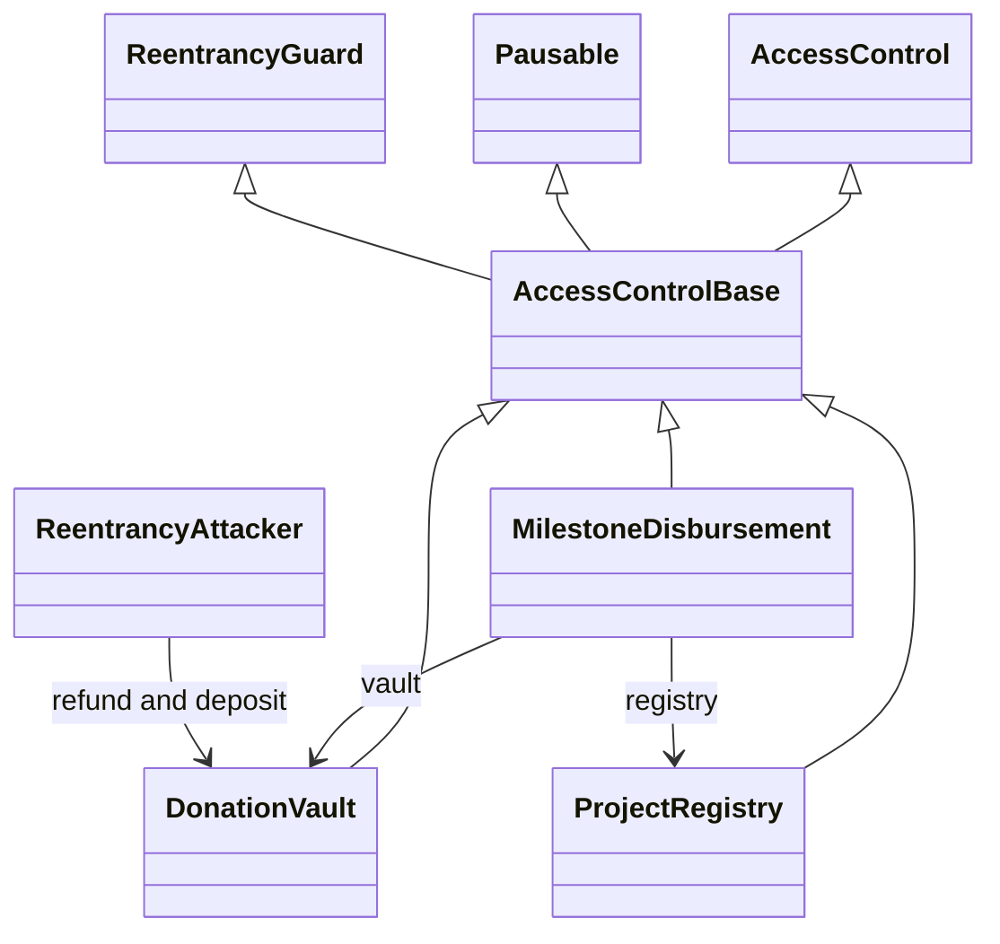

# GiveChain Member A Security Package

## Scope

This package covers the three production contracts:

- `DonationVault`
- `ProjectRegistry`
- `MilestoneDisbursement`

The test suite is in `test/GiveChain.test.js`, with `contracts/ReentrancyAttacker.sol`
used as a hostile refund caller.

## Assets and Trust Boundaries

| Asset or capability | Trusted actor | Threat |
|---|---|---|
| Vault ETH balance | MILESTONE_ROLE and DISBURSEMENT_ROLE | Unauthorized reservation or withdrawal |
| Donor ledger | Donor | Refund without sufficient contributions or committed-fund evidence |
| Refundable pool | All donors | Refund accounting that permits pooled committed or released funds |
| Project ownership | NGO_ROLE | NGO acting on another NGO's project |
| Beneficiary approval | AUDITOR_ROLE | NGO or unapproved wallet creating and releasing milestones |
| Milestone status | AUDITOR_ROLE | Duplicate release or release after rejection |
| Pause controls | PAUSER_ROLE | Unauthorized pause or operational denial |

## Threat Model

### Unauthorized access

OpenZeppelin `AccessControl` separates default admin, NGO, auditor, milestone,
disbursement, and pause roles. Negative tests verify that unauthorized accounts
cannot create projects, approve beneficiaries or milestones, reserve funds,
release funds, or pause contracts.

### Fund over-refund

The vault now maintains `totalRefundable`, a pool of donated ETH that has not
been committed to a milestone or released. Refunds require both:

1. the donor ledger has enough balance for the donor, and
2. `totalRefundable` has enough uncommitted ETH.

Reservations move ETH from `totalRefundable` to `totalCommitted`; releases move
it out of `totalCommitted` and out of the vault balance. Repeated refunds cannot
reuse a donor balance or committed funds.

Refunds are permanently disabled by the public `refundsClosed` state after the
first successful reservation. New donations remain possible after closure, but
the vault does not make them refundable. `donorBalance` is therefore historical
contribution accounting after closure, not a live refundable entitlement.

### Cross-project misuse

Beneficiary approval is scoped to `(projectId, wallet)`. A beneficiary approved
for project 1 cannot be used in project 2. Registry ownership checks also prevent
an NGO from creating or registering beneficiaries for a project it does not own.

### Reentrancy

Donation refund and milestone release paths use `nonReentrant`. Refund state is
updated before the external ETH call. The reentrancy attacker contract attempts
a second refund from its receive callback and is verified to fail while preserving
the donor ledger and refund total.

### Pause behavior

Vault and registry pause states are independent. Paused operations revert at their
contract-level pause modifier. An account without `PAUSER_ROLE` cannot pause.

## Inheritance Diagram



## Accounting Invariants

For every vault state:

- `totalRefundable <= address(this).balance`
- `totalCommitted <= address(this).balance`
- `totalRefundable + totalCommitted == address(this).balance`
- `donorBalance[donor]` is the donor's remaining refundable ledger balance
- `totalRefunded <= totalDonated`

The invariant `totalRefundable + totalCommitted == address(this).balance` holds
after donations, reservations, refunds, and releases in normal execution.

## Negative Test Evidence

The suite covers:

- zero donations and zero refunds
- refunds above donor balance
- refunds against insufficient uncommitted funds
- repeated refunds
- insufficient milestone vault funds
- unauthorized project creation and beneficiary approval
- unauthorized vault reserve and release calls
- unauthorized milestone approval
- cross-project beneficiary reuse
- unauthorized pause
- paused vault and paused registry operations
- duplicate beneficiary and identity commitment registration
- duplicate milestone approval
- reentrant refund attempt

## Validation Result

Run:

```bash
npx hardhat compile
npx hardhat test
```

The complete suite passed with 45 tests, including the original Lock tests.
